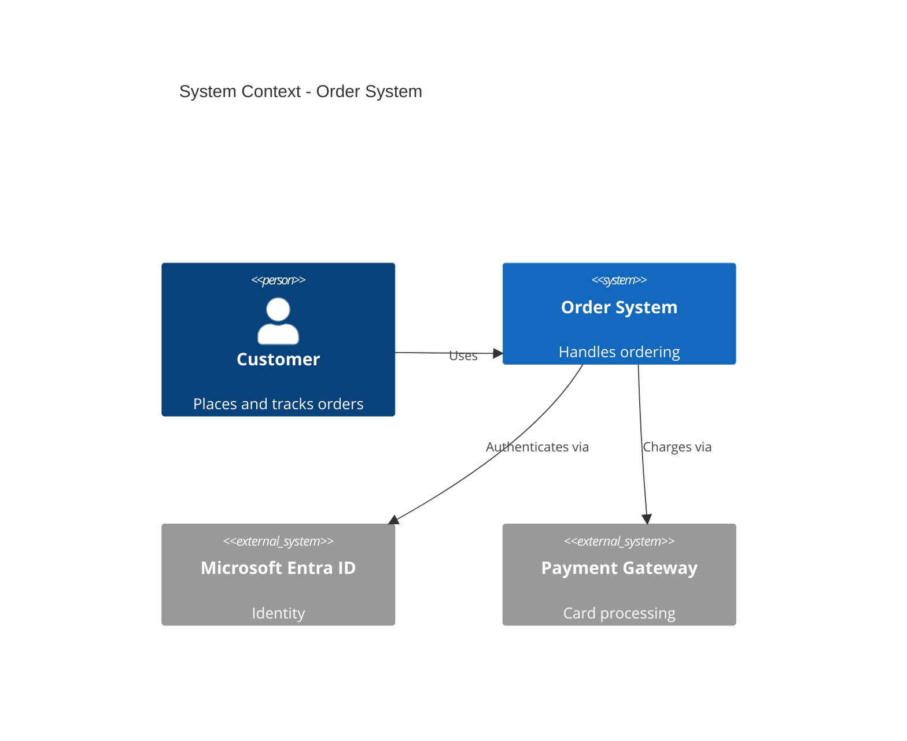
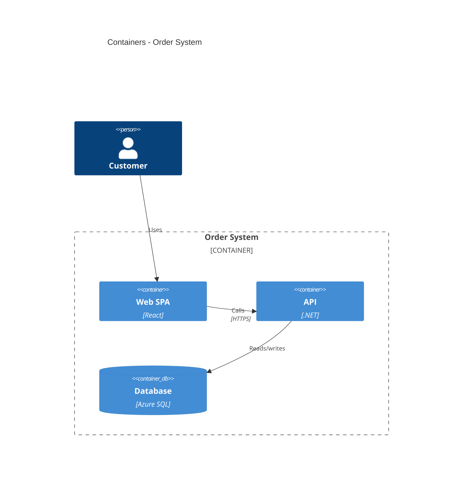

# C4 Model Diagrams

The [C4 model](https://c4model.com/) describes software architecture at four zoom levels:
**Context (L1)** -> **Container (L2)** -> **Component (L3)** -> Code (L4). This skill can
produce L1-L3 two ways: with the `diagrams` library (uses plain `Blank` boxes for the
abstract C4 elements) or with Mermaid's built-in C4 syntax (zero-install, GitHub/Azure
DevOps native).

All `diagrams` examples below are verified to render. Use `Blank` so the boxes stay
abstract (C4 is about responsibilities, not technology icons); switch to Azure nodes at L2
if you want to show the concrete Azure services.

## L1 - System Context

Who uses the system and what it talks to.

```python
from diagrams import Diagram, Cluster, Edge
from diagrams.generic.blank import Blank
from diagrams.onprem.client import Users

with Diagram("C4 L1 - System Context", show=False, direction="TB", outformat="png"):
    customer = Users("Customer")
    system = Blank("Order System\n[Software System]")
    entra = Blank("Microsoft Entra ID\n[External]")
    pay = Blank("Payment Gateway\n[External]")
    customer >> Edge(label="places orders") >> system
    system >> Edge(label="authenticates") >> entra
    system >> Edge(label="charges") >> pay
```

## L2 - Containers

The deployable/runnable units inside the system and the data stores.

```python
from diagrams import Diagram, Cluster
from diagrams.generic.blank import Blank
from diagrams.onprem.client import Users

with Diagram("C4 L2 - Containers", show=False, direction="TB", outformat="png"):
    customer = Users("Customer")
    with Cluster("Order System"):
        spa = Blank("Web SPA\n[React]")
        api = Blank("API\n[.NET]")
        worker = Blank("Worker\n[Functions]")
        db = Blank("Database\n[Azure SQL]")
    customer >> spa >> api
    api >> [db, worker]
    worker >> db
```

## L3 - Components

The major components inside one container.

```python
from diagrams import Diagram, Cluster
from diagrams.generic.blank import Blank

with Diagram("C4 L3 - API Components", show=False, direction="LR", outformat="png"):
    with Cluster("API Container"):
        ctrl = Blank("OrdersController\n[Component]")
        svc = Blank("OrderService\n[Component]")
        repo = Blank("OrderRepository\n[Component]")
    db = Blank("Database")
    ctrl >> svc >> repo >> db
```

## Mermaid C4 (zero-install)

Mermaid has first-class C4 syntax (`C4Context`, `C4Container`, `C4Component`) that renders
in GitHub and Azure DevOps with no Graphviz. Embed in a ` ```mermaid ` block.





See `references/large-diagram-strategies.md` for splitting large architectures into these
levels.
