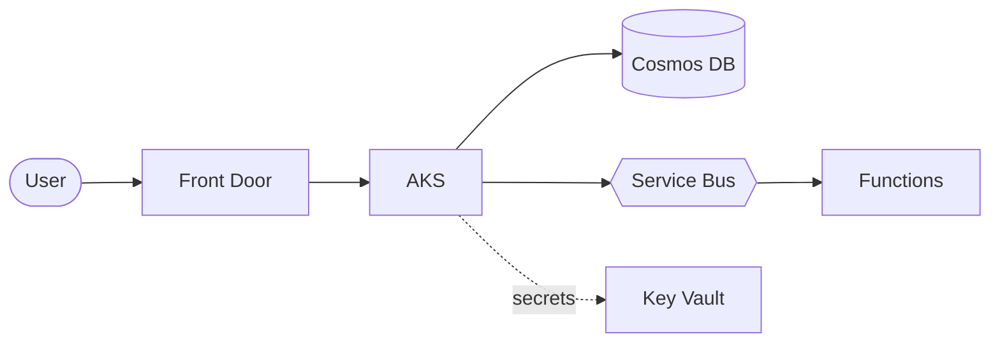
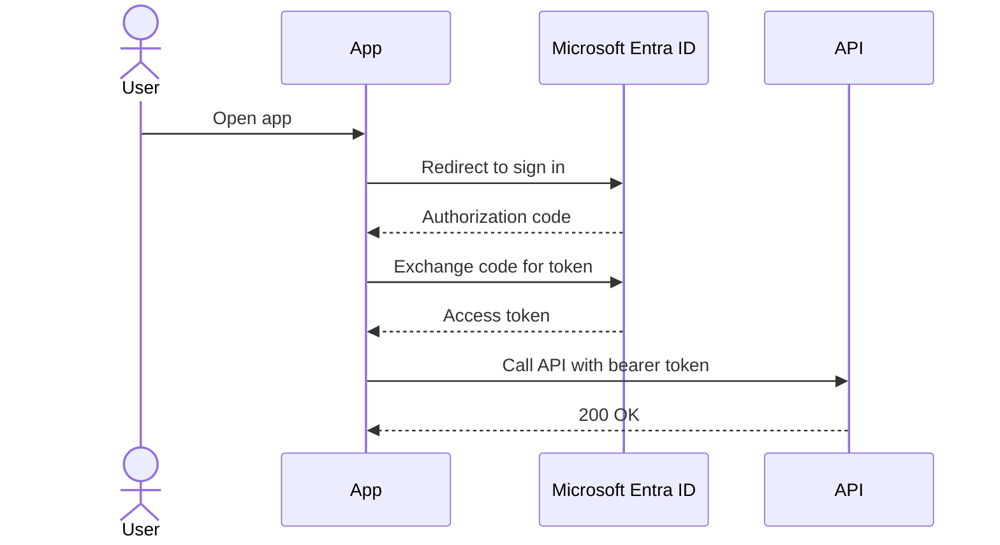
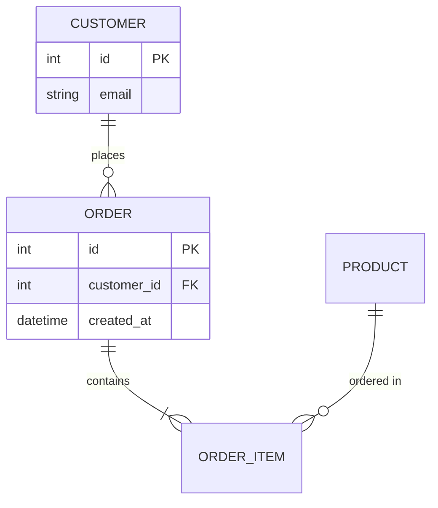
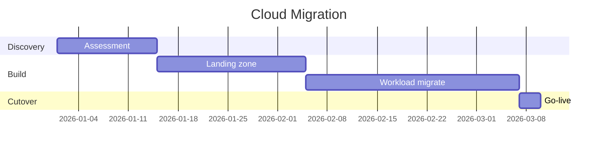
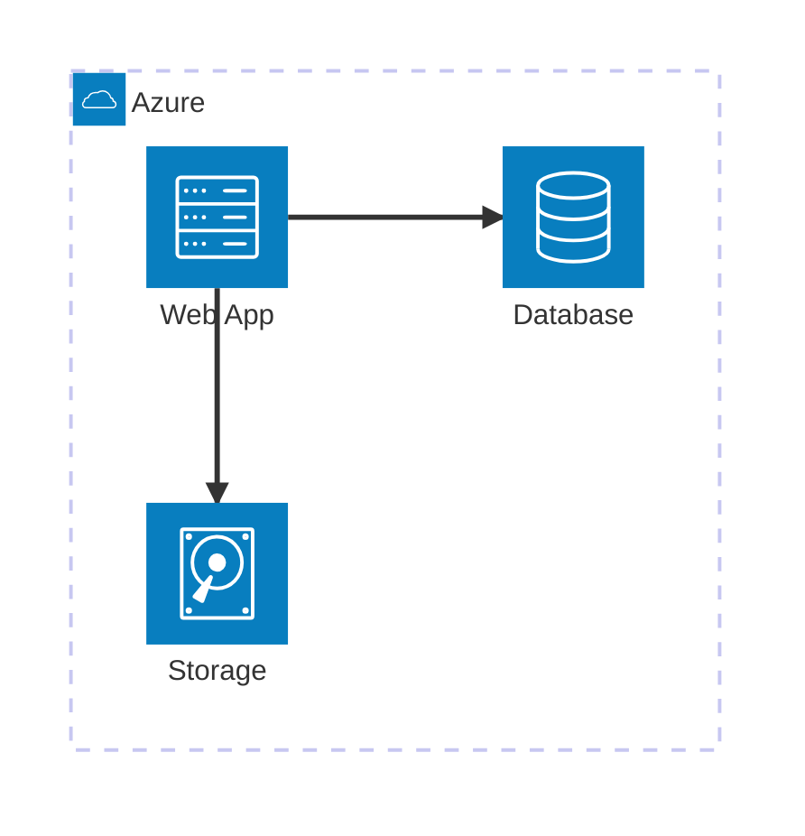

# Mermaid Output (zero-install lane)

Mermaid is a text-to-diagram syntax that renders **natively, with no install**, in
GitHub, GitLab, Azure DevOps wikis and Confluence. Use it when the diagram needs to live
inside a Markdown doc, PR, or wiki and be editable there, and when you do not need polished
Azure service icons.

## When to use which

| Need | Use |
|------|-----|
| Polished Azure service icons, PNG for slides/proposals | the `diagrams` + Graphviz pipeline (the rest of this skill) |
| Renders in a GitHub/Azure DevOps/Confluence Markdown doc with zero install | **Mermaid** (this file) |
| Quick edit-in-place flow, sequence, ER or Gantt in a repo doc | **Mermaid** |

Mermaid has **no Azure icon set**, so it is best for flows, sequences, ER and Gantt rather
than icon-rich architecture. Embed any block below in a fenced ` ```mermaid ` block.

## Flowchart (architecture-style)



## Sequence diagram (auth flow)



## Entity relationship diagram



## Gantt (project timeline)



## Architecture-beta (experimental, generic icons only)

Mermaid 11.1+ has an `architecture-beta` diagram with a small generic icon set
(`cloud`, `database`, `disk`, `server`, `internet`). It does not include Azure icons, so
for branded Azure architecture prefer the `diagrams` pipeline.


