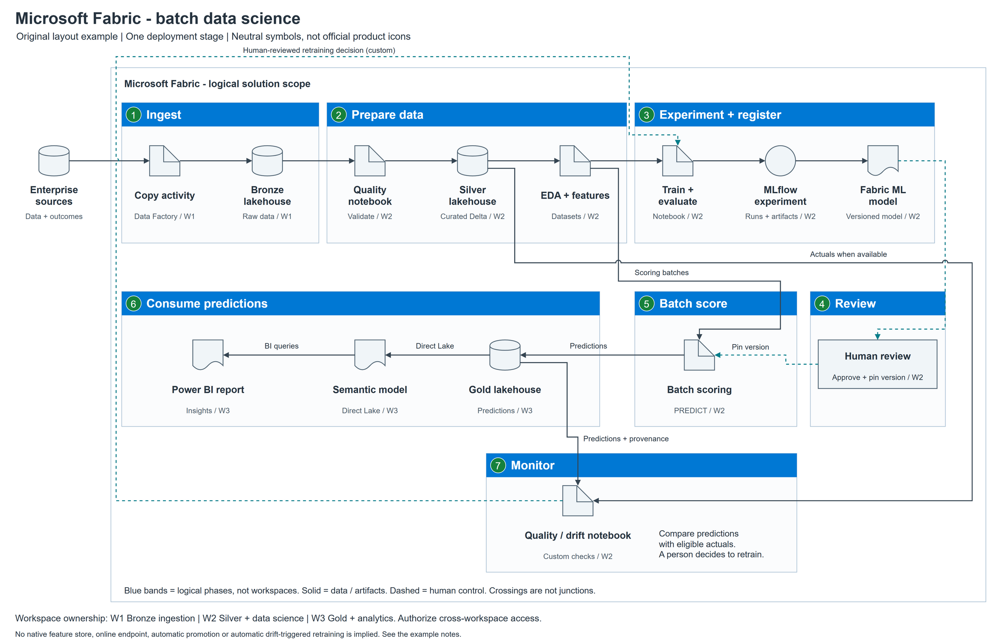

# Annotated Fabric batch data science example

An original synthetic composition, not a Microsoft diagram or deployed solution.
It demonstrates reusable drawing primitives, explicit routes and a common graph
contract without requiring an icon download.

[Editable source](architecture.drawio) | [Generator](build.py) |
[Graph contract](contract.json) | [Export hashes](architecture.render.json)

**Medium:** detailed, zoomable technical reference, not a small presentation
slide. All symbols, captions, boundaries and connectors are native editable
objects. The generic cylinder/note/document/ellipse shapes are **neutral
substitutes, not official Fabric icons**. Use approved official service symbols
in a customer deliverable when available; the helper can embed local SVGs.

## Read the composition

| Phase | Meaning and layout decision |
| --- | --- |
| 1 Ingest | Sources outside the logical Fabric scope; Copy activity in a Data Factory pipeline lands Bronze data |
| 2 Prepare | Validation into Silver, then EDA/features; reusable datasets are not a native feature store |
| 3 Experiment + register | Train/evaluate, log MLflow runs/artifacts, register a selected model version; the main row reads left to right |
| 4 Review | A distinct process box denotes custom human approval, not a fabricated managed approval service |
| 5 Batch score | Prepared scoring batches and the approved/pinned model version enter on separate ports |
| 6 Consume | Predictions flow right to left through Gold, Direct Lake and Power BI; explicit arrows and phase numbers show the wrap |
| 7 Monitor | Predictions/provenance and delayed actuals enter separately; the perimeter control path denotes a human retraining decision |

W1/W2/W3 tags express proposed workspace ownership. Blue phase bands do not
pretend to be workspaces, networks or security boundaries. Their widths follow
the number of components rather than an equal-card grid.

Two downwards data lanes remain separate from captions. Feedback returns around
the perimeter and enters training from above rather than covering its data
input. Arrow labels occupy explicit rectangles. Crossings are not junctions.
The [generator](build.py) shows exact placement/port choices for reuse.

The checker caught overlapping annotation rectangles and routes through reserved
header/label space during authoring. Those were corrected before export.
Visual inspection then caught an unnecessarily wrapped model caption, which was
shortened. This illustrates why geometry checks and image inspection complement
one another rather than either replacing the other.

## Architecture guardrails

The [contract](contract.json) has 15 canonical components and 17 typed directed
relationships. It represents one deployment stage and a proposed three-workspace
governance arrangement. Authorize cross-workspace access; the figure does not
include every scheduling, permission or operational dependency.

Split data before fitting learned transforms. Retain fitted transforms,
reproducibility information, and a populated MLflow model signature. PREDICT
requires a supported model flavor/runtime; pin model name/version. Gold should
retain entity keys, prediction time and model provenance. Actuals require
eligible keys/time windows. Direct Lake has capacity, security and framing
guardrails; no zero-latency guarantee is made.

Approval and statistical quality/drift evaluation are custom. No native feature
store, automatic retraining, Azure ML endpoint, AKS or Dev/Test/Prod promotion
is implied.

Technical sources, consulted during the 2026-11-02 diagram work:

- [Fabric data science lifecycle](https://learn.microsoft.com/en-us/fabric/data-science/tutorial-data-science-introduction)
- [PREDICT requirements](https://learn.microsoft.com/en-us/fabric/data-science/model-scoring-predict)
- [Direct Lake](https://learn.microsoft.com/en-us/fabric/fundamentals/direct-lake-overview)

The [Architecture Center MLOps v2 image](https://learn.microsoft.com/en-us/azure/architecture/ai-ml/guide/machine-learning-operations-v2)
was inspected during that work. Section hierarchy, numbered phases and perimeter
feedback were borrowed, not its Azure ML topology. No reference screenshot or
Microsoft product artwork is redistributed here.

## Reproduce and inspect

From the skill folder, follow [the tooling commands](../../references/tooling.md)
to generate into a new output directory. Deliberately updating this checked-in
example requires `build.py --output-dir .\examples\fabric-batch --overwrite`,
then an intentional local PNG export with `--overwrite`. Rerun the contract and
preview checks, inspect the final image and refresh the repository's reviewed
CSA source-lock entries. Never overwrite user-edited diagrams casually.

The source was generated, checked, locally rendered with draw.io Desktop 32.6.1
on Windows and visually inspected. This is helper/example execution, **not**
verified host skill activation, a comparative model benchmark or live Fabric
execution. The packaged export record binds the final source and preview.
