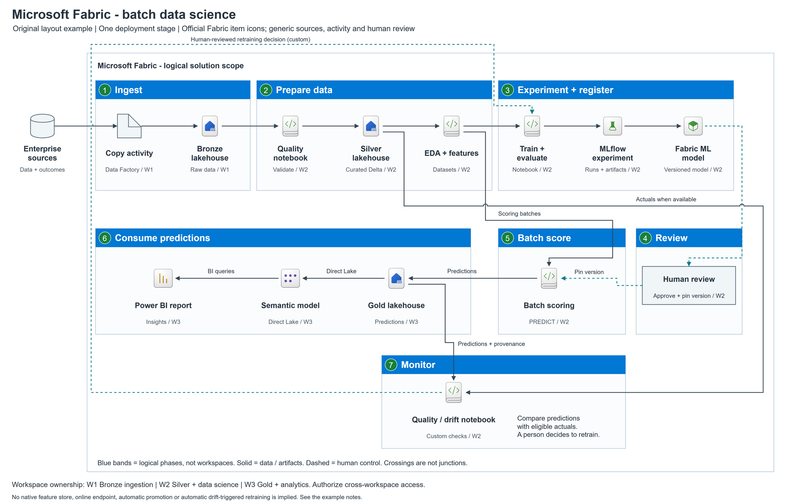

# Fabric batch data science with official item icons

[Editable source](architecture.drawio) | [Generator](build.py) |
[Contract](contract.json) | [PNG hashes](architecture.render.json) |
[Browser text measurements](architecture.text.json)

This variant reuses the [neutral Fabric example's topology and assumptions](../fabric-batch/README.md).
It adds the [curated official Fabric symbols](../../assets/fabric/README.md)
without changing the required nodes, ownership or relationships. Enterprise
sources, the copy activity and human review remain disclosed neutral symbols.
In particular, a pipeline icon is not used to pretend to be a copy activity.

Raw-to-curated data preparation, training/MLflow tracking, model selection,
human approval, batch PREDICT, Gold/Direct Lake/Power BI consumption and custom
quality monitoring remain explicit. This is not online serving, a native
feature store or automatically triggered retraining.

The Microsoft archive license and icon usage guidance accompany the SVGs.
Labels, process boxes and connectors remain native editable objects; the SVG
symbols are embedded without modifying their original bytes or proportions.
The source/PNG and browser text were checked and the final image inspected.
No Fabric workspace was accessed or deployed.

Generate to a new directory with `python .\build.py --output-dir <directory>`;
use the [local export](../../references/tooling.md) and
[quality checks](../../references/quality-checks.md).
