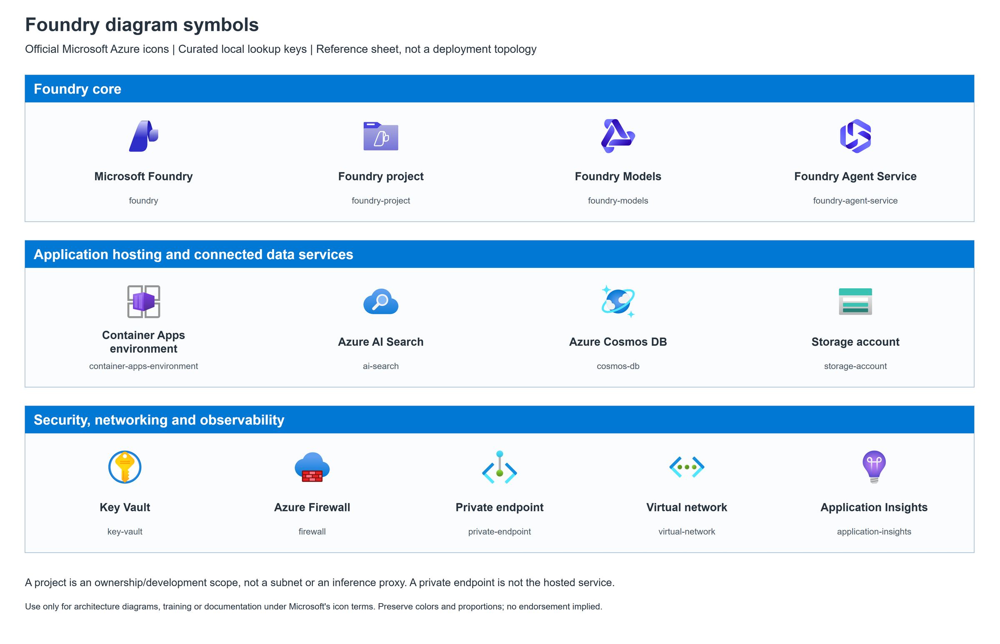

# Foundry icon reference sheet



[Editable draw.io](architecture.drawio) | [Generator](build.py) |
[Contract](contract.json) | [Export hashes](architecture.render.json)

This original sheet demonstrates all **13 curated official SVGs** and their
stable lookup keys. The grid is a symbol reference, **not** a proposed topology,
deployment recipe or set of mandatory dependencies. No runtime arrows are
invented. Its `icon-reference` scope is catalog metadata, not a cloud workspace.
Use [Foundry guidance](../../references/foundry.md) when composing an architecture.

The four core symbols are Microsoft Foundry, Foundry project, Foundry Models
and Foundry Agent Service. The other nine cover common connected Azure services,
hosting, security, networking and observability. All preserve their original
bytes, colors and proportions. Symbols are embedded SVG images; labels and
grouping are native editable objects, not a single flattened screenshot.

Microsoft's [original icon terms](../../assets/foundry/Microsoft_Terms_of_Use.pdf)
apply to the symbols, including those embedded in the diagram/preview.
These assets are **not relicensed under MIT**. See
[asset provenance and permitted uses](../../assets/foundry/README.md).

From the skill folder, generate into a new output directory:

```powershell
python .\examples\foundry-icons\build.py --output-dir .\output\foundry-icons
python .\scripts\check_diagram.py .\output\foundry-icons\architecture.drawio --contract .\output\foundry-icons\contract.json --strict
```

Use the [local export instructions](../../references/tooling.md) for a PNG.
Regenerating this bundled reference intentionally requires `--overwrite`.
The sheet was generated, rendered with draw.io Desktop 32.6.1 on Windows and
visually inspected. This demonstrates icon/helper rendering, not host skill
activation, a live Foundry deployment or architectural correctness.
