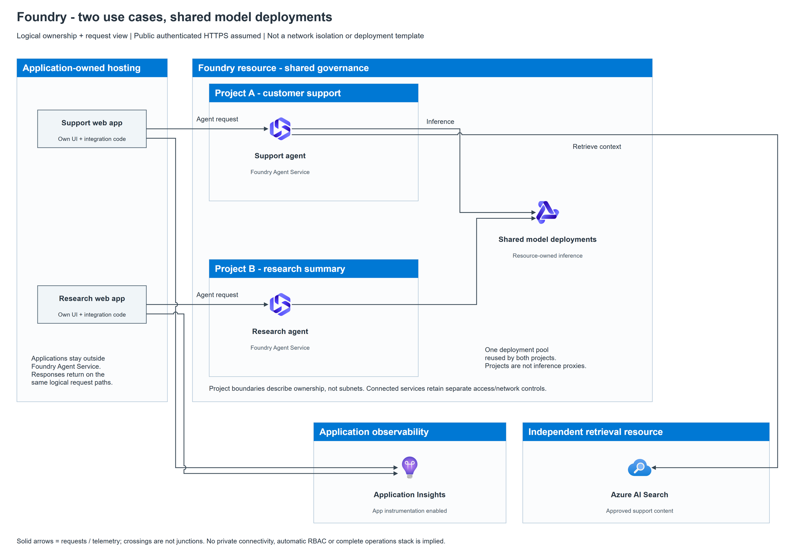

# Foundry multi-project reference architecture

[Editable source](architecture.drawio) | [Generator](build.py) |
[Ownership/relationship contract](contract.json) |
[PNG hashes](architecture.render.json) | [Browser text measurements](architecture.text.json)

This synthetic **logical ownership/request view** has two application-owned
web apps invoking agents in separate Foundry projects. Both agents reuse
resource-owned model deployments; the support agent additionally uses a
configured Azure AI Search tool. Separately configured app instrumentation
sends telemetry to Application Insights. Responses return on the corresponding
request paths; arrows summarize dependencies, not a time-ordered protocol trace.

## Explicit choices

- Current Foundry resource/project model, not classic hub/workspace architecture.
- Projects own agent configurations/assets; the hosting is Foundry Agent Service.
  The web apps and their integration code are not hosted in Agent Service.
- Public authenticated HTTPS is assumed for this teaching example. No private
  endpoint, delegated subnet, outbound-isolation, DNS or firewall guarantee is
  inferred. An enterprise private-network version needs a separate verified design.
- Search is an independently governed resource containing approved support
  content. The configured agent tool requires its own access/connection setup.
  It is not a mandatory dependency of the research agent or every agent setup.
- Exact agent type/version, model/SKU/region, content filters, identities/RBAC,
  authentication flow, Search ingestion and operations/DR are deployment
  decisions intentionally outside this logical view. No resources were deployed.
- Project containment is ownership/development scope, **not network isolation**.
  Model calls do not traverse a project icon as a presumed proxy.

## Evidence

Reviewed 2026-11-02:
[Foundry architecture](https://learn.microsoft.com/en-us/azure/foundry/concepts/architecture)
documents the resource/project hierarchy, shared deployments and independently
governed connected services.
[Azure AI Search agent tool](https://learn.microsoft.com/en-us/azure/foundry/agents/how-to/tools/ai-search)
describes configured retrieval; verify its current model/agent restrictions
before applying this pattern.
[Application Insights instrumentation](https://learn.microsoft.com/en-us/azure/azure-monitor/app/app-insights-overview)
supports explicitly configured application telemetry, not automatic collection.

The original drawing uses the [curated official Azure icons](../../assets/foundry/README.md);
their Microsoft terms also apply to embedded artwork in source/preview.
Native labels/boundaries/connectors are editable; product icons are embedded SVGs.

The explicit contract checks graph inventory, intent and declared containment.
The source/PNG and browser-laid-out text were checked and the final PNG inspected.
That is not a cloud deployment, security audit or customer acceptance test.
Rebuild into a new directory with `python .\build.py --output-dir <directory>`,
then use the [local exporter](../../references/tooling.md) and
[deeper checks](../../references/quality-checks.md).
